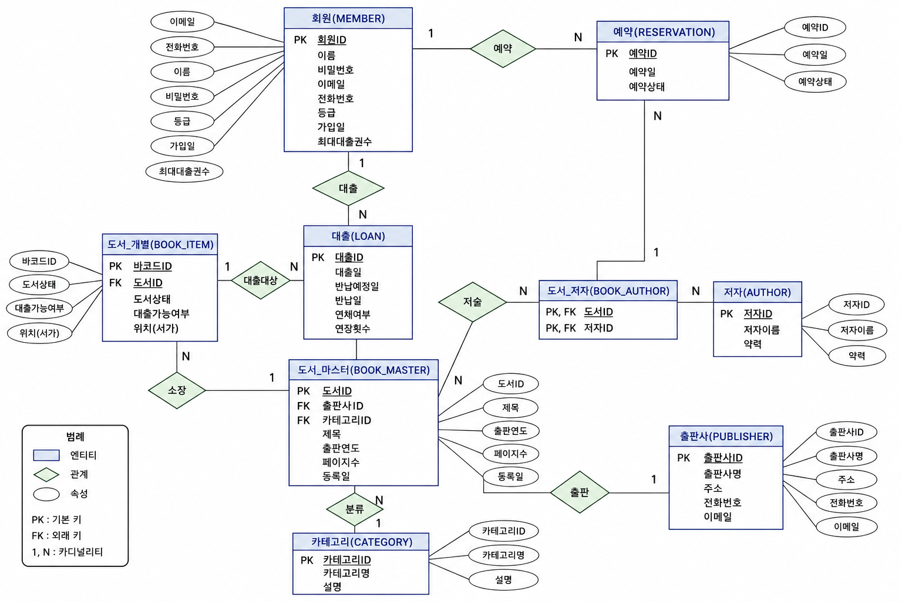

# 도서관 대출 관리 시스템 - DB 구현 (MySQL)

수업(데이터베이스) 팀 프로젝트(4인)에서 설계한 **9개 테이블을 MySQL에 직접 구현**하고, 대출·반납·연장·연체·예약·통계 SQL을 작성한 개인 프로젝트입니다.
팀 프로젝트에서는 ERD 설계와 정규화 분석, 테이블 명세까지 했고, 이 저장소에서는 그 설계가 실제 DB에서 돌아가는지 구현해 확인했습니다.

- 개발 기간: 2026.10 ~ (진행 중)
- 범위: DB와 SQL만 다룹니다. 화면(웹)은 없습니다. (화면까지 만든 프로젝트는 [budget-erp](../../../budget-erp)입니다.)

## 테이블 (9개)

| 구분 | 테이블 | 설명 |
|---|---|---|
| 기준 정보 | `member` | 회원. 시스템이 만드는 인공키가 PK, 주민등록번호는 UNIQUE |
| | `publisher` | 출판사 |
| | `category` | 카테고리(장르) |
| | `author` | 저자 |
| | `book_master` | 도서 마스터. 책 한 종류의 공통 정보(제목, ISBN, 출판연도 ...) |
| | `book_item` | 도서 개별(복본). 서가에 꽂힌 실제 책 한 권, 바코드로 구분 |
| | `book_author` | 도서 x 저자 교차 테이블 (다대다 해소) |
| 이력 정보 | `loan` | 대출. 빌릴 때마다 한 줄, 반납하면 반납일을 채움 |
| | `reservation` | 예약. 모든 복본이 대출 중인 도서에 신청 |

테이블 컬럼과 제약 조건은 [docs/logical-model.png](docs/logical-model.png)(논리 모델)에 있고, 실제 DDL은 [`db/library_db.sql`](db/library_db.sql)에 있습니다.

## 설계에서 신경 쓴 점

- **정규화**: 저자 이름을 문자열로 한 칸에 넣으면 공동 저자를 표현할 수 없어서 `author`로 분리했고(1NF), 도서 x 저자 다대다는 `book_author`(복합 PK)로 풀었습니다(2NF). 출판사와 카테고리는 도서에서 분리해 이행적 종속을 없앴습니다(3NF).
- **도서 마스터와 복본 분리**: 같은 책을 여러 권 가진 도서관에서는 "책의 정보"와 "실물 한 권"이 다릅니다. 대출은 복본(`book_item`) 단위로, 예약은 도서 마스터 단위로 받습니다.
- **계산할 수 있는 값을 컬럼으로 저장**: `book_item.loan_available`(대출가능여부)과 `loan.overdue_yn`(연체여부)은 대출 테이블에서 계산할 수도 있지만 조회가 잦아 저장하고, 대출·반납 때 같은 트랜잭션에서 함께 갱신합니다.
- **삭제 규칙을 명시**: 복본이 있는 도서 마스터, 대출 이력이 있는 회원·복본은 지울 수 없게 `ON DELETE RESTRICT`로 두었고, 도서를 지울 때 도서_저자 매핑만 `CASCADE`로 함께 정리합니다.
- **CHECK 제약**: 회원 등급, 최대 대출 권수(1~10), 복본 상태, 대출가능여부, 연체여부, 연장 횟수(최대 2회), 대출일과 반납예정일 순서, 예약 상태.

## SQL 목록 (`db/library_db.sql`)

**업무 SQL**
- 대출: 복본 행을 `FOR UPDATE`로 잠근 뒤, 대출 INSERT와 `loan_available = 'N'` UPDATE를 한 트랜잭션으로 처리
- 반납: 반납일 기록, 연체 여부 판정, `loan_available = 'Y'` 복귀를 한 트랜잭션으로 처리
- 연장: 반납 전 + 연체 아님 + 연장 2회 미만일 때만 반납예정일 +7일
- 연체 갱신: 반납예정일이 지났는데 반납하지 않은 대출을 연체(Y)로 표시
- 대출 가능 회원 점검: 남은 대출 권수와 연체 중인 책 수
- 예약: 빌릴 수 있는 복본이 하나도 없을 때만 등록

**조회·통계 SQL**
- 현재 대출 현황 (회원, 복본, 도서 마스터 JOIN)
- 연체 목록과 연체일수
- 도서별 대출 횟수 TOP 3
- 카테고리별 대출 통계
- 회원별 누적 대출 횟수 (`HAVING`)
- 도서별 복본 수와 대출 가능 권수
- 도서별 저자 (다대다를 거쳐 공동 저자를 한 줄로)
- 월별 대출 건수
- 예약 대기 목록

파일 끝에는 무결성 규칙(삭제 제한, 복합 PK 중복, UNIQUE, CHECK)을 직접 확인해 볼 수 있는 문장이 주석으로 들어 있습니다. 주석을 풀어 실행하면 오류가 나는 것이 정상입니다.

## 실행 방법

1. MySQL 8을 설치합니다.
2. [`db/library_db.sql`](db/library_db.sql)을 전체 실행합니다. `library_db` 데이터베이스가 만들어집니다. (기존 `library_db`가 있으면 지우고 다시 만듭니다.)
3. 실행하면 샘플 데이터가 들어가고, 업무 SQL과 통계 SQL의 결과가 차례로 출력됩니다.

샘플 데이터는 모두 가상의 값입니다. 대출·반납 SQL은 오늘 날짜(`CURDATE()`)를 쓰므로 실행한 날에 따라 일부 날짜가 달라집니다.

## 한계와 앞으로 할 것

- 화면과 서버가 없어 SQL을 직접 실행해 확인합니다. 대출 가능 조건(남은 권수, 연체 여부) 검사는 SELECT로 보여 주고, 실제 프로그램이라면 Service에서 이 값을 보고 INSERT 여부를 결정해야 합니다.
- `member.resident_id`는 `VARCHAR(14)`라 암호화한 값을 담을 수 없습니다. 설계 문서에는 암호화를 적용한다고 되어 있지만 이 구현에서는 평문 길이만 다룹니다. 실제 서비스라면 주민등록번호를 저장하지 않는 쪽이 맞습니다. (샘플은 가상 값입니다.)
- MySQL 기준입니다. `DATE_ADD`, `DATE_FORMAT`, `DATEDIFF`, `GROUP_CONCAT`, `LIMIT`은 Oracle에서는 각각 날짜 덧셈(`+ 7`), `TO_CHAR`, 날짜 뺄셈, `LISTAGG`, `FETCH FIRST`나 `ROWNUM`으로 바꿔야 합니다.
- 예약이 `완료` 상태로 바뀌는 흐름(반납 시 예약자에게 알림)은 아직 구현하지 않았습니다.
